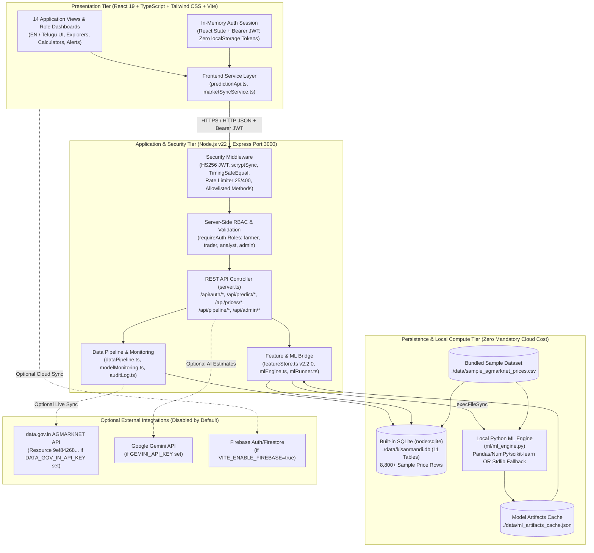
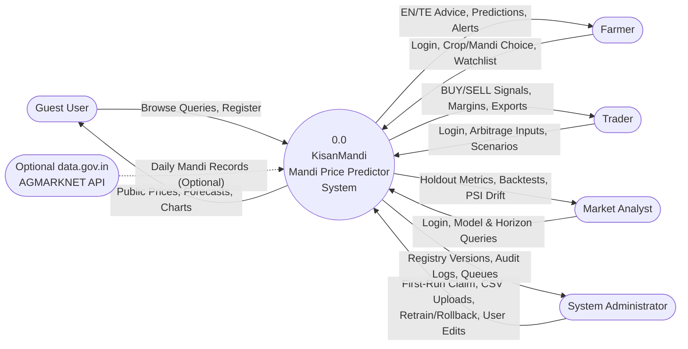
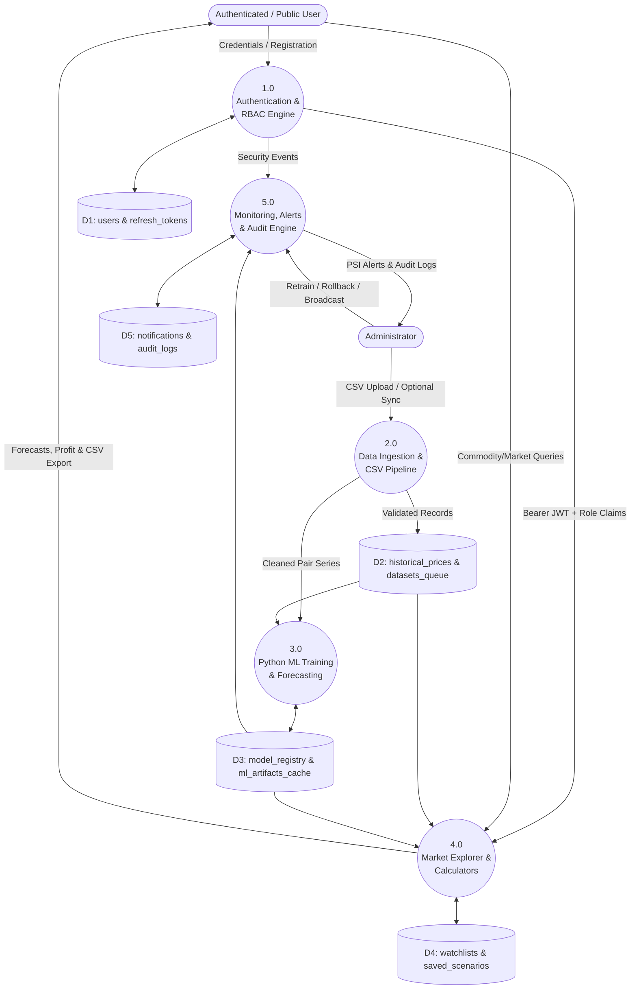
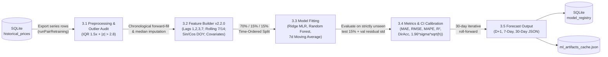
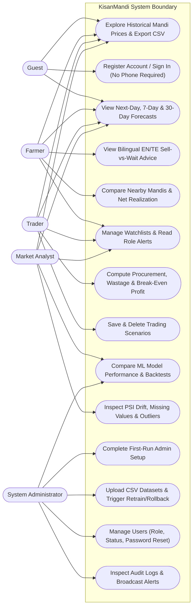
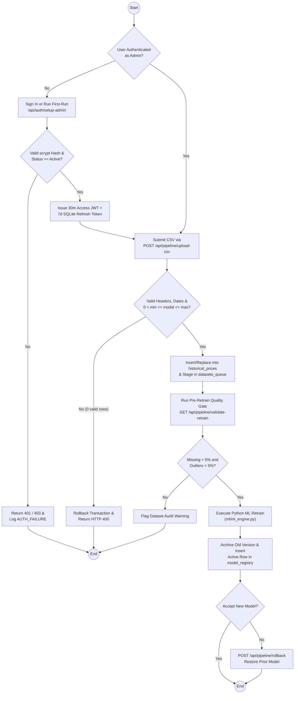
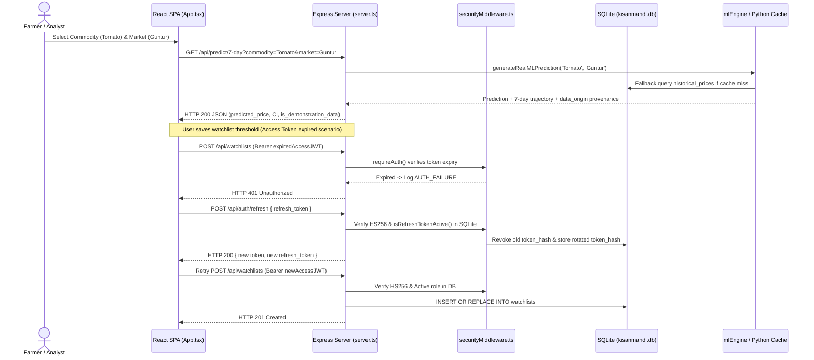
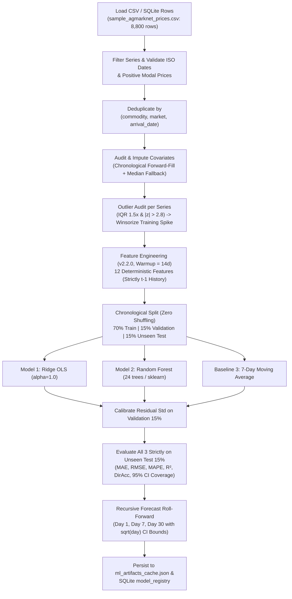

# KisanMandi – System Architecture & UML/DFD Diagrams

All diagrams in this document are written in **Mermaid** syntax for maintainability and render directly in GitHub, VS Code, Notion, and Markdown-to-PDF academic converters. Every entity, table, endpoint, actor, and pipeline stage matches the implemented codebase (`server.ts`, `server/*.ts`, `ml/ml_engine.py`, `src/App.tsx`).

---

## 1. High-Level System Architecture Diagram

---

## 2. Entity–Relationship (ER) Diagram (SQLite Schema — `server/database.ts`)

```mermaid
erDiagram
    USERS {
        TEXT id PK
        TEXT name
        TEXT email UK
        TEXT password_hash
        TEXT role "farmer|trader|analyst|admin"
        TEXT state
        TEXT district
        TEXT preferred_market
        TEXT preferred_commodities "JSON array"
        TEXT language "en|te|hi"
        INTEGER alerts_enabled
        TEXT alert_channels "JSON array"
        TEXT phone "Optional metadata"
        TEXT status "Active|Deactivated"
        TEXT created_at
        TEXT last_login
    }

    REFRESH_TOKENS {
        TEXT token_hash PK
        TEXT user_id FK
        INTEGER expires_at
        INTEGER revoked
        TEXT created_at
    }

    WATCHLISTS {
        TEXT id PK
        TEXT user_id FK
        TEXT state
        TEXT market
        TEXT commodity
        REAL target_price
        TEXT alert_condition "above|below"
        TEXT created_at
    }

    SAVED_SCENARIOS {
        TEXT id PK
        TEXT user_id FK
        TEXT crop_group
        TEXT crop_name
        TEXT state
        TEXT market
        TEXT inputs_json
        REAL predicted_price_quintal
        REAL predicted_price_tonne
        TEXT created_at
    }

    NOTIFICATIONS {
        TEXT id PK
        TEXT role_target
        TEXT alert_type
        TEXT commodity
        TEXT market
        TEXT state
        TEXT alert_date
        REAL current_price
        REAL predicted_price
        TEXT expected_change
        TEXT risk_level
        TEXT recommended_action
        TEXT message
        INTEGER is_disabled
        TEXT created_at
    }

    NOTIFICATION_READS {
        TEXT user_id PK,FK
        TEXT alert_id PK,FK
        TEXT read_at
    }

    HISTORICAL_PRICES {
        INTEGER id PK
        TEXT arrival_date "Composite UK"
        TEXT state
        TEXT district
        TEXT market "Composite UK"
        TEXT commodity "Composite UK"
        TEXT variety
        TEXT grade
        REAL min_price
        REAL max_price
        REAL modal_price
        REAL arrival_tonnes
        REAL rainfall_mm
        REAL temp_c
        TEXT data_source "sample|csv_upload|live"
        TEXT created_at
    }

    MODEL_REGISTRY {
        TEXT id PK
        TEXT version
        TEXT commodity
        TEXT market
        TEXT algorithm
        TEXT feature_set_version
        TEXT dataset_snapshot
        TEXT hyperparameters
        REAL mae
        REAL rmse
        REAL mape
        REAL r2
        REAL directional_accuracy
        TEXT approval_status
        TEXT status "Active|Archived|RolledBack"
        INTEGER training_dataset_size
        TEXT data_origin
        TEXT trained_at
    }

    DATASETS_QUEUE {
        TEXT id PK
        TEXT filename
        TEXT source
        INTEGER rows_count
        TEXT missing_pct
        INTEGER duplicate_rows
        TEXT status "Pending Review|Approved|Rejected"
        TEXT uploaded_by
        TEXT uploaded_at
    }

    PIPELINE_RUNS {
        INTEGER id PK
        TEXT source
        TEXT source_url
        INTEGER record_count
        TEXT status
        TEXT failure_reason
        INTEGER retry_attempts
        TEXT executed_at
    }

    AUDIT_LOGS {
        TEXT id PK
        TEXT timestamp
        TEXT user_id
        TEXT user_email
        TEXT role
        TEXT ip_address
        TEXT method
        TEXT path
        TEXT action
        TEXT details
    }

    USERS ||--o{ REFRESH_TOKENS : "owns_sessions"
    USERS ||--o{ WATCHLISTS : "monitors"
    USERS ||--o{ SAVED_SCENARIOS : "saves"
    USERS ||--o{ NOTIFICATION_READS : "reads"
    NOTIFICATIONS ||--o{ NOTIFICATION_READS : "tracked_in"
    USERS ||--o{ AUDIT_LOGS : "generates_events"
```

---

## 3. Data Flow Diagrams (DFD Level 0, Level 1, and Level 2)

### 3.1 Level 0 — Context Diagram

### 3.2 Level 1 — System Functional Decomposition

### 3.3 Level 2 — ML Forecasting & Retraining Data Flow

---

## 4. UML Use-Case Diagram

---

## 5. UML Activity Diagram (Authentication, CSV Upload & Retraining Flow)

---

## 6. UML Sequence Diagram (Authenticated Forecasting, Refresh Rotation & CSV Export)

---

## 7. Machine Learning Workflow Diagram (`ml/ml_engine.py`)

